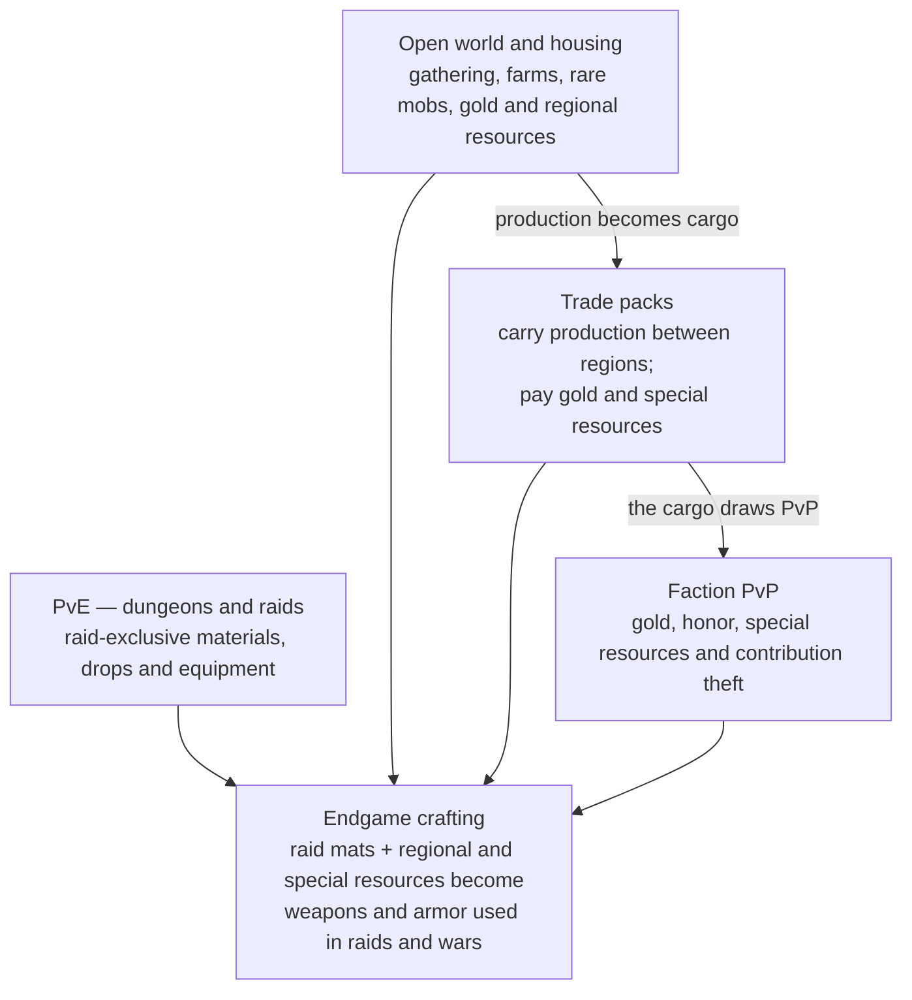

No activity lives in isolation: PvE, PvP, the open world and trade packs produce different resources that meet in endgame crafting, and the resulting gear goes back to the raids and the wars.

*Resource flow · 4 activities, 1 destination: PvE, PvP, the open world and trade packs converge in endgame crafting.*

*Resource flow · 4 activities, 1 destination (diagram from the 13 October version)*

Trade packs link the two halves: they carry the open world's production, create the PvP that pays honor and special resources, and build the regions through node missions and projects. Exploration feeds all of it with charts, routes and access to rare resources, and the world auction lets every player, PvE or PvP, sell what they make.
