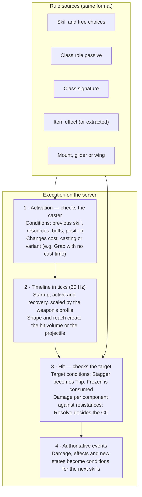

Every skill is built from data components: damage type, delivery, shape, timeline, effects, CC, conditions, world utility and interaction rules. The components are also the tags that the skill pools, the role passives and the unique effects read, so tuning one component tunes every skill that uses it at once.

### Damage types and defenses

Damage is described by combinable components. The damage type only decides which defenses apply: it never causes an effect, a CC or a condition by itself. A skill can split the hit into parts. E.g. Flaming Blade \= 70% Physical \+ Melee \+ Slash and 30% Magical \+ Melee \+ Elemental (fire).

| Axis | Components | What it does |
| :---- | :---- | :---- |
| Domain | Physical, Magical | Picks the armor pool: physical or magical armor |
| Delivery | Melee, Ranged, Area | Coefficients and magic Guard read it; Area also triggers decreasing damage per target |
| Physical subtype | Slash, Pierce, Blunt | A small matrix against armor weight, averaged per piece; Blunt also spends more Guard when blocked |
| Magic subtype | Elemental (fire, ice, lightning and other elements), Arcane, Occult | Rules against the defense tools, never stats on items |

* **Slash:** \+10% against cloth, 0 against leather, −10% against plate.  
* **Pierce:** 0 against cloth, \+10% against leather, 0 against plate.  
* **Blunt:** −10% against cloth, 0 against leather, \+10% against plate.  
* **Elemental:** magical armor and a full Guard block it; it builds Burn, Chill and Shock.  
* **Arcane:** ignores about 30% of magical armor; a full Guard blocks it; no conditions. Exclusive to the Arcane Discipline.  
* **Occult:** passes through Guard at reduced damage (e.g. 50%); lower raw damage; curses, which can be cleansed.  
* Magic subtypes are countered by playing (dodge, block, cleanse), never by gearing, so there are no enchant chores.  
* **Creature traits** live on the content side: Armored (counts as plate), Ethereal (takes half physical damage) and Fire-born (immune to Burn). The bestiary reveals them.

### Effects, CC and conditions

Effects, CC and conditions are separate components that the skill declares. Most hits are only damage, which keeps combat readable.

| Component | Family | How it works |
| :---- | :---- | :---- |
| Stun, Knockdown, Trip, Root, Stagger | Hard CC | Declared by the skill and applied directly; limited by Resolve |
| Slow | Light CC | Declared by the skill, or while Chill is active; limited by the slow cap |
| Concussion | Effect | Damage to Guard and a Daze |
| Armor Break | Effect | Lowers defense |
| Burn, Chill, Shock, Poison, Bleed, Curse, Madness, Acid | Condition | Build-up per source; the peak gives the extra effect; limited by Tolerance |

| Skill (example) | Damage components | Declared effect, CC or condition |
| :---- | :---- | :---- |
| Light attack (Sword) | Physical · Melee · Slash | None |
| Thrust (Spear) | Physical · Melee · Pierce | Adds to the Stagger meter |
| Shield Bash (Sword \+ Shield) | Physical · Melee · Blunt | Concussion; Stun with an effect cooldown |
| Shot (Bow) | Physical · Ranged · Pierce | None |
| Piercing Arrow (Bow) | Physical · Ranged · Pierce | Armor Break |
| Rending Arrow (Ranger, War) | Physical · Ranged · Slash | Bleed build-up |
| Ice Lance (Wand) | Magical · Ranged · Elemental (ice) | Chill build-up |
| Meteor (Staff) | Magical · Area · Elemental (fire) | Burn build-up |
| Arcane Strike (Quarterstaff, Arcane) | Magical · Melee · Arcane | None (no build-up) |

### Balance per component

Each component has a global coefficient, separate for PvE and PvP, and a damage part inherits the product of its components' coefficients. If Area is too strong in wars, lower Area's PvP coefficient and every area skill adjusts together. Coefficients and the armor constant are set in development and playtests. Besides the coefficients, any value can declare its own PvE and PvP values (see [[Combat]]).

```text
D_final = D_base × Π k_c × E_role × (1 − R_pool) × M_subtype
R_pool = A ÷ (A + K)   (proposal; never reaches 100%)
```

D\_base \= the Balance Profile value (base, PvE or PvP); k\_c \= the coefficient of each component of the damage part (PvE or PvP); E\_role \= efficiency from the Roles table; A \= the target's armor in the pool of the hit's domain, blended per piece; M\_subtype \= the physical subtype multiplier against the armor weight, or the magic subtype rule. One curve per pool is easier to read and balance than multiplying layers of resistances.

### Skill anatomy

Almost everything is a standard component; only truly unique behavior goes into the Custom component.

| Component family | What it describes | Examples | Visible to the player |
| :---- | :---- | :---- | :---- |
| Identity | Where it comes from and how it is classified | Weapon kit or Discipline pool, tags (Opener, Finisher) | Yes |
| Activation | When it can be used and what it costs | Cost, cooldown, cast time, requirements | Yes |
| Timeline | The rhythm of the strike | Startup, active, recovery, cancel window | No |
| Shape | Where the strike happens | Cone, circle, line, projectile; origin; range | Range yes, hitbox no |
| Damage | How much and of what type | Damage parts with their components | Yes |
| Effect | What stays after the strike | Concussion, Armor Break, Slow, buffs, with duration | Yes |
| Condition | Build-up added per hit | Burn, Chill, Bleed… with the amount per hit | Yes |
| Control | CC that goes through Resolve | Stun, Knockdown, Trip, Root, Stagger | Yes |
| Movement | The caster's movement | Advance, leap, step back, rooted while casting | Yes |
| Defense | The skill's own Guard and dodge | Frontal Guard during a dash, iframe | Yes |
| Threat and protection | The skill's weight in PvE and PvP | Threat multiplier, Challenge | No |
| World utility | What the skill does for exploration | Lighting (radius, duration, intensity), revealing a path | Yes |
| Custom | Unique behavior written in code | On kill, the bleed jumps to the nearest enemy | Only the description |
| Interactions | Condition → modifier rules | See the framework below | Only the description |

**The Custom rule.** A custom effect never replaces the standard components. If a custom skill causes Bleed, it has both the Custom component and the Bleed component, so defenses, coefficients, caps, Tolerance and item effects still apply to it.

### Hidden attributes, public attributes and timing profiles

| Type | Attributes | Unit | Where it shows |
| :---- | :---- | :---- | :---- |
| Hidden | Startup (animation until the strike), active, recovery, cancel window | Ticks of the combat domain (30 Hz; 1 tick ≈ 33 ms) | In the feel of the strike and in debug tools |
| Public | Damage, effects, effect, buff and area durations, cooldown, cost, cast time | Values and seconds, converted to ticks on the server | Tooltip and interface |

Each weapon has one timing profile (there are no versatile weapons, so no second grip profile): it sets the rhythm of the light and heavy attacks and scales the recovery of the weapon's skills. That way a sword strike recovers faster than a spear strike without every skill repeating it.

| Weapon | Light: startup / recovery (ticks) | Heavy: startup / recovery (ticks) | Skill recovery scale | Feel |
| :---- | :---- | :---- | :---- | :---- |
| Sword | 6 / 8 | 12 / 16 | 1.0× | Fast |
| Spear | 10 / 14 | 18 / 26 | 1.3× | Slow, controls space |
| Greatsword | 12 / 18 | 22 / 32 | 1.5× | Heavy |

The other loadouts get their profiles in development.

### Interaction framework

Every interaction is a rule with three parts, condition, modifier and scope, and the same language serves the skills of the pools, the role passive, the class signature, the unique effects of items (including the gems from extraction) and the mount, glider and wing modifications. A new skill is data, not code.

| Part | Types | Examples |
| :---- | :---- | :---- |
| Condition | Target state; caster state; previous skill or tag within a window of ticks; position; context | Target in Stagger · Fury above 50 · after Downward Kick within 45 ticks · from behind · on a ship · in the dark |
| Modifier | Change a value; swap a component; add a component; unlock a variant; consume a state | Cast time \= 0 · Stagger becomes Trip · add Bleed build-up · consume Frozen and deal Shatter |
| Scope | This skill; skills with a tag; every skill of the weapon kit | The Support passive applies to every Finisher |

* **Earth Grasp after Downward Kick:** condition \= the last skill was Downward Kick within the last 45 ticks; modifier \= cast time 0\.  
* **Stagger that becomes Trip:** condition \= target already in Stagger; modifier \= swap the Stagger control component for Trip. Resolve still decides whether the CC lands in full, lowered or not at all.  
* **Frozen \+ Spear:** condition \= target Frozen; modifier \= consume Frozen and swap Stagger for Knockdown.

**A resolver in two moments.** The server checks the rules when the skill activates (caster conditions: cost, cast time, variant) and when it hits (target conditions: control swaps, extra effects, build-up). In each moment the order is fixed: component swaps, then additions, then value changes (summed per category, with a cap) and only then defenses. No result depends on the order in which the player equipped things.



*Skill resolver · 5 sources, 2 checks: rules from five sources are checked at two moments, activation and hit.*

*Skill resolver · 5 sources, 2 checks (diagram from the 13 October version)*

The states created by a hit (Stagger, Frozen, a Shock mark, condition build-up) are the conditions the next skills read: that is how ArcheAge-style combos appear without hand-written pairs.

### Skill API (illustrative format)

```yaml
# Rending Arrow — Bow, War pool (Ranger)
id: game:rending_arrow
loadout: bow
pool: war                    # Discipline skill; costs skill points
tags: [opener, projectile]
activation: { cost: { mana: 20 }, cooldown_s: 8, cast_s: 0.4 }
timing:                      # hidden, ticks at 30 Hz
  startup: 10
  active: 2
  recovery: 14               # x the Bow's profile scale
shape: { kind: projectile, origin: socket, range_m: 28, homing: false }
damage:
  - share: 1.0
    components: [physical, ranged, slash]
    base: 120
    pvp: 100                 # optional; without it the base applies
conditions:
  - bleed: { add_s: 3.0, pvp: { add_s: 2.0 } }   # declared; slash alone never bleeds
interactions:
  - when: { target_has: bleed, percent_gte: 50 }
    at: hit
    do: { add_component: armor_break }
---
# Earth Grasp — Quarterstaff weapon kit
id: game:earth_grasp
loadout: quarterstaff
pool: weapon                 # basic kit; unlocked by level, no points
activation: { cooldown_s: 14, cast_s: 1.0 }
shape: { kind: circle, origin: crosshair_point, radius_m: 4 }
damage:
  - share: 1.0
    components: [magic, area, elemental]
    base: 60
control: root
interactions:
  - when: { previous_skill: game:downward_kick, within_ticks: 45 }
    at: activation
    do: { set: { cast_s: 0 } }
---
# Arcane Torch — Wand weapon kit (world utility)
id: game:arcane_torch
loadout: [wand_shield, wand_focus]
pool: weapon
activation: { cooldown_s: 30, cast_s: 0.5 }
world_utility:
  light: { radius_m: 12, duration_s: 120, intensity: 0.8 }
```

In the technical document each component uses an engine API: damage goes through hit resolution with the game's attributes and rules, effects and conditions use status storage with the game's application policies, control uses the control primitives, the timeline runs in the ability toolkit in ticks of the 30 Hz domain, and interactions become condition → modifier rules in the rules pipeline. The engine provides the mechanisms and the resolver; the game provides the rules, the values and the few Customs (see [[Engine gameplay APIs (Engine)#Mechanism and policy|Mechanism and policy]]).
